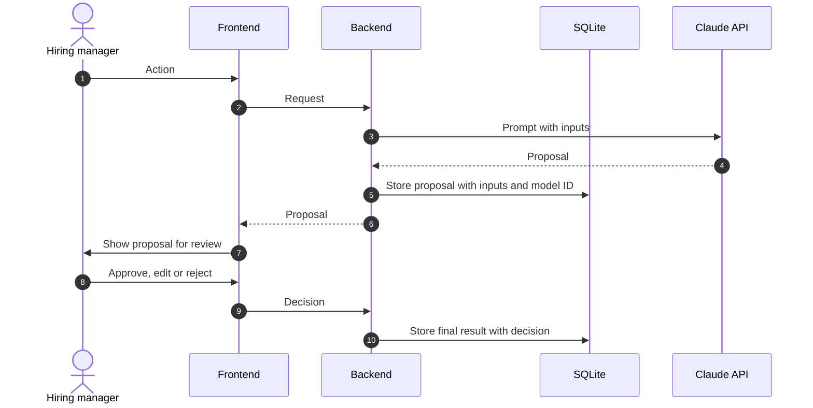

# Feature name

Status: draft
Ticket: `spec/features/<folder>/FNNNN-<slug>.md`
Last reviewed: YYYY-MM-DD

## Purpose

What the hiring manager does in this flow, in one or two sentences.

## Participants

- **Hiring manager**: the person using the application.
- **Frontend**: React single-page application. Talks to the backend over HTTP only.
- **Backend**: Python server on the interviewer's machine.
- **SQLite**: local database under `data/`.
- **Claude API**: the LLM provider. The only external service in the flow.

Add participants only when they appear in the sequence below.

## Sequence

## Human decision points

- Step where the hiring manager decides, and what they can do: approve, edit, reject.

## Records kept

- What is stored, where, and for how long.
- For each AI output: inputs, model ID, prompt version, timestamp.

## Data leaving the machine

- The exact fields sent to the Claude API in each request.

## Open questions

- Question that the diagram depends on.
