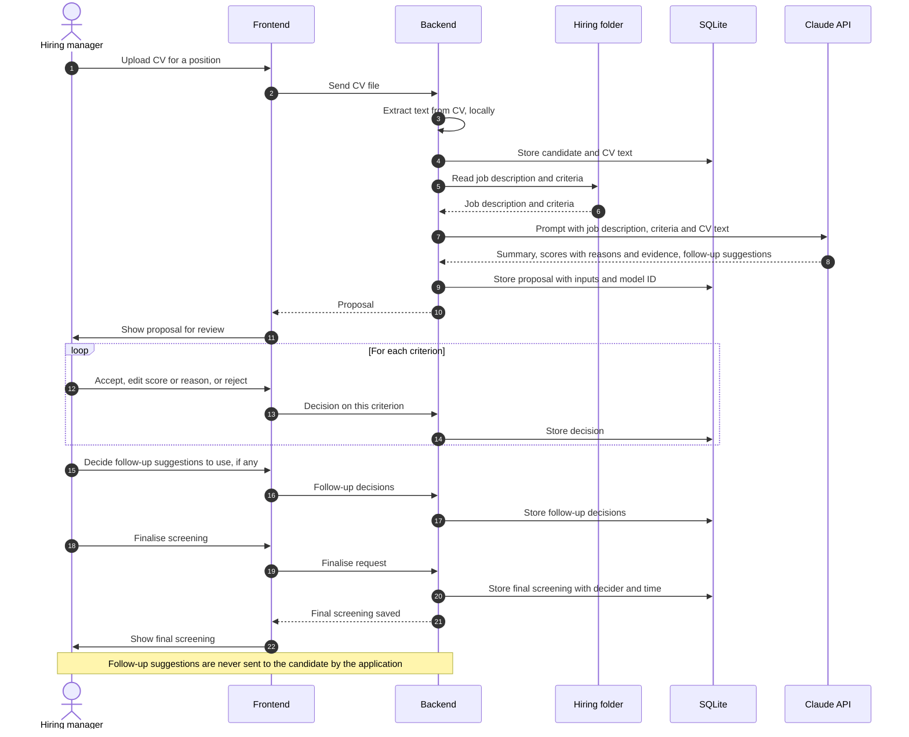

# Candidate screening

Status: draft
Ticket: `../../spec/features/planned/F0009-candidate-screening.md`
Last reviewed: 2026-10-15

## Purpose

The hiring manager gives the application a candidate's CV for a position. The assistant proposes a screening summary, a score for each criterion with the reason and the evidence behind it, and follow-up suggestions. The hiring manager decides the final screening result. Nothing is sent to the candidate.

## Participants

- **Hiring manager**: the person using the application. Makes every decision.
- **Frontend**: upload, review and decision screens.
- **Backend**: extracts text from the CV, builds the prompt and stores the records.
- **SQLite**: candidate record, proposals, decisions and final results, under `data/`.
- **Claude API**: produces the proposals.
- **Hiring folder**: source of the job description and the screening criteria.

## Sequence

## Human decision points

- The hiring manager reviews every criterion score and reason, and can change them.
- The hiring manager decides which follow-up suggestions to use. The application does not act on them.
- The final screening exists only after the hiring manager finalises it.

## Records kept

- Each proposal: CV text used, job description and criteria version, prompt version, model ID, timestamp.
- Each decision: who decided, what changed from the proposal, timestamp.
- Final screening: links to the proposal it came from.
- Retention of CV files and text is an open question below.

## Data leaving the machine

- CV text, job description and criteria, sent to the Claude API. This is the only candidate data that leaves the machine.
- The CV file itself is not sent. Only the extracted text is.

## Open questions

- Is the CV file kept in `data/`, or only the extracted text? (See `CLAUDE.md`, Open Questions.)
- Which candidate fields are stored, and how long are they kept?
- What does the score scale look like, and where do the criteria come from?
