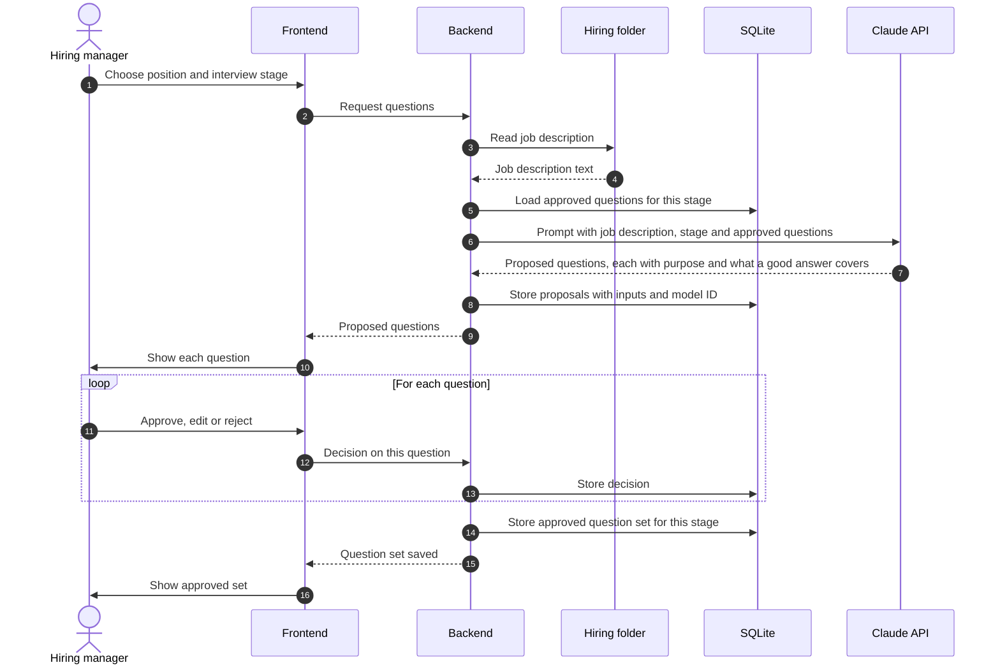

# Talk with the user about interview questions

Status: draft
Ticket: F0003
Last reviewed: 2026-10-15

## Purpose

For a position and an interview stage, the assistant proposes interview questions. The hiring manager approves, edits or rejects each question. Only approved questions become the question set for that stage.

## Participants

- **Hiring manager**: the person using the application.
- **Frontend**: question review screen.
- **Backend**: builds the prompt from the job description, the stage and the questions already approved.
- **SQLite**: stores proposals, decisions and the approved question sets.
- **Claude API**: produces the proposed questions.
- **Hiring folder**: source of the job description.

## Sequence

## Human decision points

- Each question is approved, edited or rejected one by one. Rejected questions are not stored as final.
- The approved set is what the hiring manager uses in interviews. Proposals alone are never treated as final.

## Records kept

- Each proposal batch: job description version, stage, approved questions used as context, model ID, timestamp.
- Each decision: approve, edit or reject, with the edited text where relevant.

## Data leaving the machine

- Job description text, stage name and approved questions, sent to the Claude API.
- No candidate data in this flow.

## Open questions

- Should the approved question set also be exported to the `hiring/` folder?
- How many questions per proposal batch?
