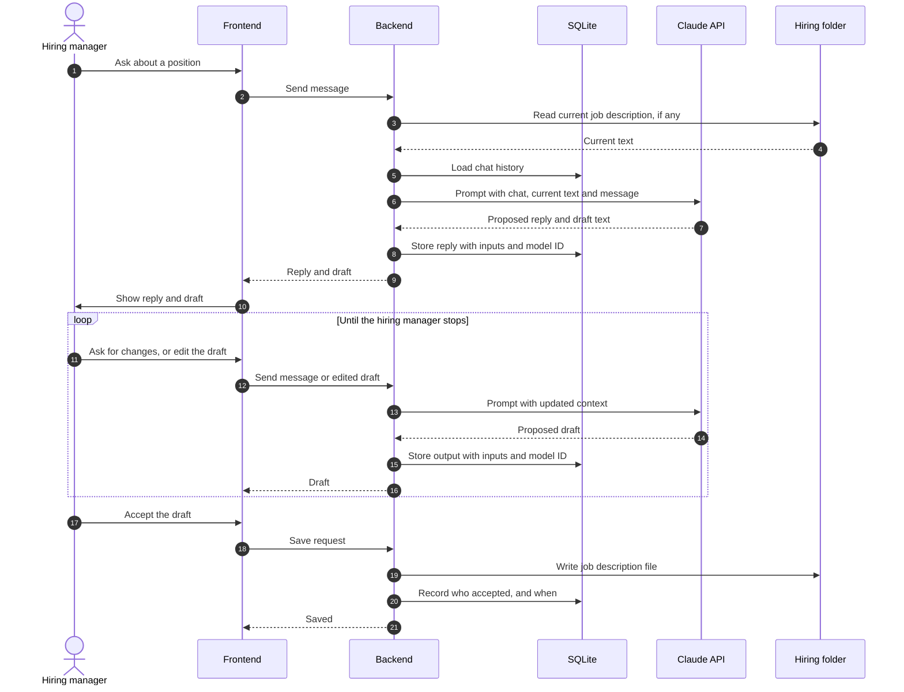

# Talk with the user about jobs

Status: draft
Ticket: F0002
Last reviewed: 2026-10-15

## Purpose

The hiring manager discusses a position in a chat with the assistant. The assistant proposes job description text. The hiring manager decides what is saved to the `hiring/` folder.

## Participants

- **Hiring manager**: the person using the application.
- **Frontend**: React chat screen and draft view.
- **Backend**: builds the prompt from the chat, the current job description and the messages so far.
- **SQLite**: stores the chat and the AI output records.
- **Claude API**: produces the proposed text.
- **Hiring folder**: `hiring/<position>/<position>.md`, the saved job descriptions.

## Sequence

## Human decision points

- Every draft is shown to the hiring manager. Nothing is written to `hiring/` without an explicit accept.
- The hiring manager can edit the draft before accepting it. The saved text is the edited version.

## Records kept

- Each AI output: chat messages used, job description version used, model ID, timestamp.
- The accepted file in `hiring/` is the final result. The SQLite record links it to the draft that produced it.

## Data leaving the machine

- Chat messages and the current job description text, sent to the Claude API.
- Job descriptions contain no candidate data. This flow does not send candidate data.

## Open questions

- Is the chat history kept per position, or per session?
- Does the saved job description need a version history in the `hiring/` folder, or only in SQLite?
