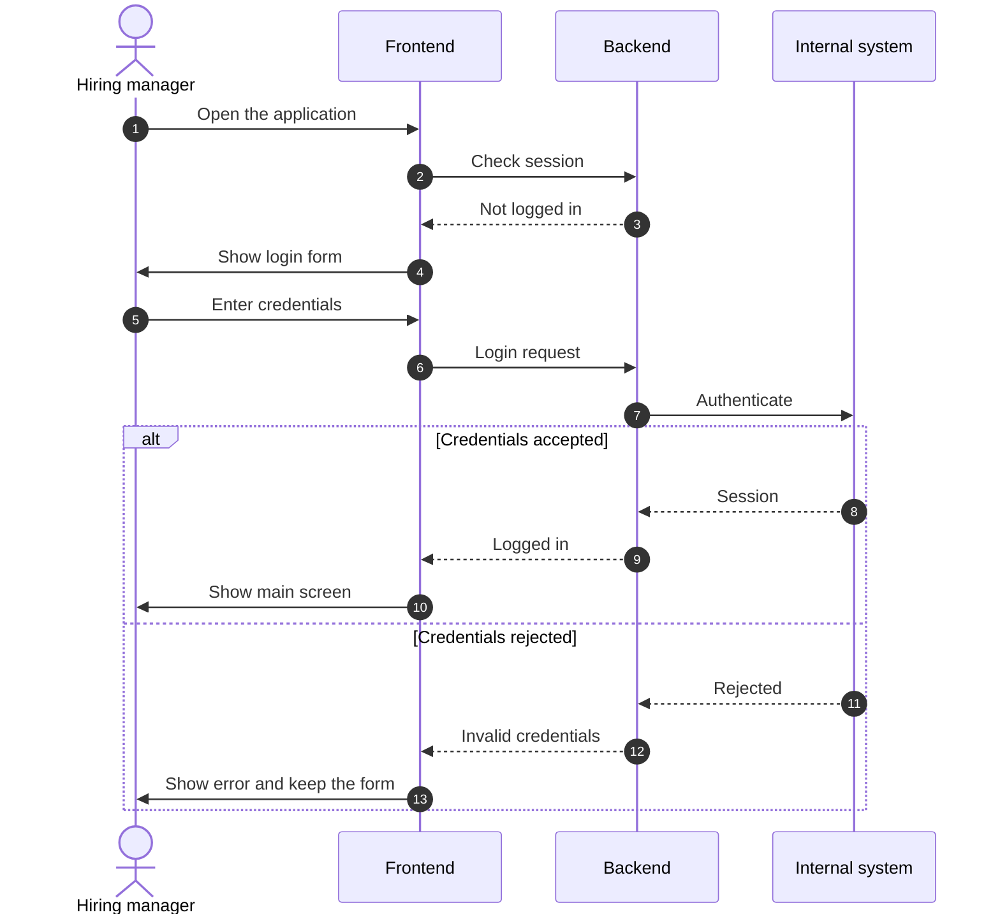

# Login to the internal system

Status: draft
Ticket: none yet
Last reviewed: 2026-10-15

## Purpose

The hiring manager logs in to the internal system from the application. The application uses the result to access what the internal system offers. The login mechanism of the internal system is not yet known.

## Participants

- **Hiring manager**: the person using the application.
- **Frontend**: React single-page application.
- **Backend**: Python server on the interviewer's machine. The only component that talks to the internal system.
- **Internal system**: the company system the hiring manager logs in to.

## Sequence

## Human decision points

- The hiring manager enters the credentials. The application does not log in on its own.

## Records kept

- Login events are not AI outputs, so no LLM record is needed.
- Credentials are not written to `data/`. Where the session is kept is an open question below.

## Data leaving the machine

- Credentials and session go only to the Internal system. Nothing goes to the Claude API in this flow.

## Open questions

- How does the internal system authenticate: username and password, an API token, or SSO?
- Where is the session kept, in backend memory or in a local file?
- Does the application need to re-authenticate after a set time?
