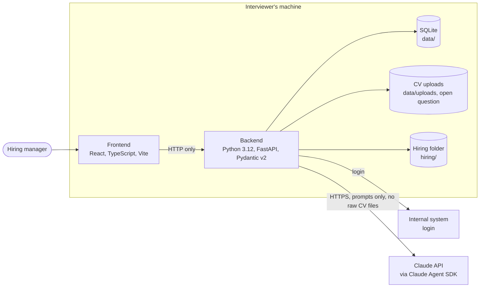

# System overview

Status: draft
Ticket: F0001, F0002, F0003
Last reviewed: 2026-10-15

## Purpose

Component view of the chosen stack, showing what runs on the interviewer's machine and what leaves it. The per-feature sequence diagrams are in the other documents of this folder.

## Diagram

## Components

| Component | Technology | Where it runs | Notes |
| --- | --- | --- | --- |
| Frontend | TypeScript, React, Vite | Browser on the interviewer's machine | Built in F0001. Tests with Vitest and React Testing Library. |
| Backend | Python 3.12, FastAPI, Pydantic v2 | Local process on the interviewer's machine | The only component that calls the Claude API and the Internal system. |
| Persistence | SQLite | `data/` file, not committed | Holds candidates, proposals, decisions and AI output records. |
| LLM | Claude API via the Claude Agent SDK and the Claude Code CLI (ADR-0008) | External, HTTPS | Signed in with the hiring manager's subscription. The only external service that receives candidate-derived text. |
| Hiring folder | Markdown files | `hiring/` in the repository | Job descriptions, one folder per position. |
| Internal system | To be decided | External | Login only. See `login.md`. |

## Boundaries

- The frontend talks to the backend only over HTTP. It never calls the Claude API or the Internal system directly.
- Candidate data leaves the machine only as prompts to the Claude API. Raw CV files are not sent.
- Every LLM call is recorded with its inputs and model ID before its result reaches the hiring manager.

## Tooling

| Purpose | Tool |
| --- | --- |
| Python environment and dependencies | `uv` (defined in `pyproject.toml`) |
| Lint and format | `ruff` |
| Type checking | `ty` |
| Backend tests | `pytest` |
| Frontend tests | Vitest, React Testing Library |

## Open questions

- Where are CV files stored: `data/uploads`, or only the extracted text in SQLite?
- Which Internal system is used for login, and how does it authenticate?
