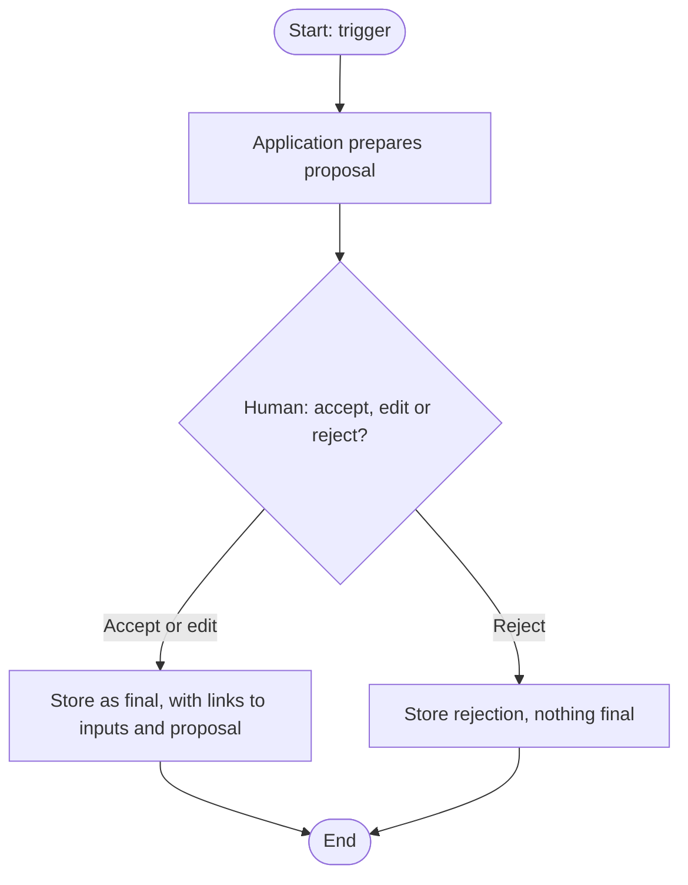
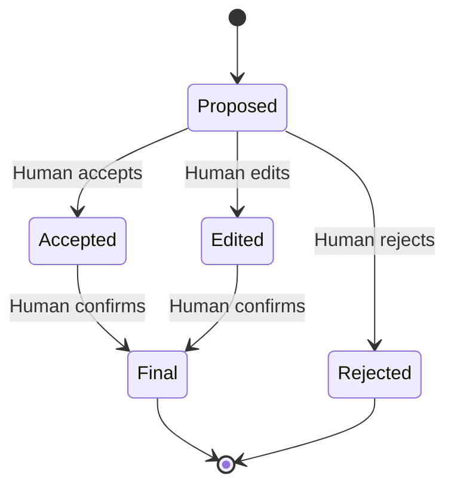

# Business specification: Short title

Status: draft
Owner: hiring manager
Last reviewed: YYYY-MM-DD

## Summary

Two or three sentences: what the hiring manager gets from this, and why it matters for the hiring process.

## Business goal and success measures

- Goal: what changes for the hiring manager once this works.
- Success measure: how we will know it works, stated in terms the hiring manager can observe.

## Scope

In scope:

- Item that this specification covers.

Out of scope:

- Item deliberately excluded, and the reason in a few words.

## Actors

| Actor | Role in this process |
| --- | --- |
| Hiring manager | Makes every decision that affects a candidate. |
| Application | Prepares proposals, stores records. Never decides. |
| Claude API | Produces proposals from the inputs it is given. |

## Business process

The flowchart shows the whole process. Steps that a person must do are marked `Human`. Every proposal must pass through a `Human` decision before it is stored as final.

## Lifecycle of the key record

Show the states a record can be in and what moves it between them. Remove this section if the feature has no lifecycle.

## Business rules

Number each rule. Each rule must be testable: a reader should be able to say whether the application follows it.

1. BR-01: Rule in plain language.
2. BR-02: Rule in plain language.

## Data and records

- What is stored, and why the hiring manager needs it.
- Retention: how long it is kept, or the open question about it.

## Human decision points

- Each point where a person approves, edits or rejects something, and what happens to the result.

## AI outputs

Each output the system proposes, and what it records.

- Output name. Inputs used, model ID, prompt version, timestamp.

## Candidate data boundary

- Candidate data that leaves the machine, and the reason.
- Candidate data that stays on the machine.

## Ticket breakdown

Each row becomes one ticket in `spec/features/planned/`. Create the tickets with `/spec` in ticket mode. The business rules the ticket covers are its user stories.

| Proposed ticket | Business rules covered | Status |
| --- | --- | --- |
| Short title | BR-01, BR-02 | not created |

## Links

- Architecture: `../../docs/architecture/<feature>.md`
- Decisions: `../../docs/adr/NNNN-<decision>.md`

## Open questions

- Question that must be answered before tickets are created or started.

## Assumptions

- Assumption made to keep this specification moving, and who should confirm it.
