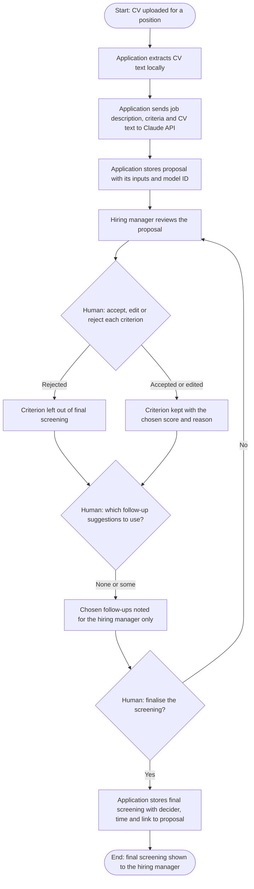
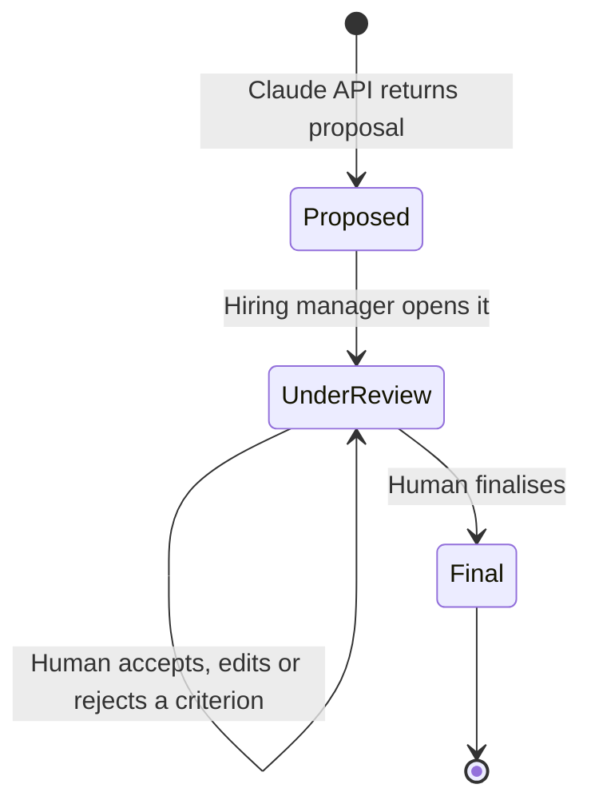

# Business specification: Candidate screening

Status: draft
Owner: hiring manager
Last reviewed: 2026-10-22

## Summary

For a position, the hiring manager gives the application a candidate's CV. The assistant proposes a screening summary, a score for each criterion with its reason and evidence, and follow-up suggestions. The hiring manager decides every score and the final screening. Nothing is sent to the candidate.

## Business goal and success measures

- Goal: the hiring manager screens CVs against the position criteria faster, and every screening result traces back to the CV evidence and the proposal it came from.
- Success measure: every final screening links to a stored proposal, and the hiring manager changes or rejects at least one item in the proposal before finalising. The second part is a check that the review step is real, not a rubber stamp.

## Scope

In scope:

- Uploading one CV for one position.
- The proposed screening: summary, criterion scores with reasons and evidence, follow-up suggestions.
- Human review of each criterion, and finalising the screening.

Out of scope:

- Ranking or comparing several candidates.
- Automatic rejection, or any decision made without the hiring manager.
- Sending the screening, a score or a follow-up to the candidate.
- Scheduling interviews from a screening result.
- CV formats beyond the first set (see open questions).

## Actors

| Actor | Role in this process |
| --- | --- |
| Hiring manager | Reviews every criterion, decides follow-ups, finalises the screening. |
| Application | Extracts CV text locally, builds the prompt, stores proposals and decisions. Never decides. |
| Claude API | Produces the proposal from the job description, criteria and CV text. |

## Business process

## Lifecycle of the screening

## Business rules

1. BR-01: A screening is requested for one CV and one position.
2. BR-02: The CV file is read on the local machine. Only the extracted text, with the job description and criteria, is sent to Claude API.
3. BR-03: The proposal contains a summary, one score per criterion with its reason and evidence, and follow-up suggestions.
4. BR-04: The hiring manager accepts, edits or rejects each criterion on its own.
5. BR-05: The original proposal is stored unchanged, even when the hiring manager edits a score or reason.
6. BR-06: A rejected criterion is left out of the final screening.
7. BR-07: Follow-up suggestions are shown for the hiring manager to use or ignore. The application does not act on them.
8. BR-08: A final screening is stored only after the hiring manager finalises it. It records the decider, the time and the proposal it came from.
9. BR-09: The application offers no way to send the screening, a score or a follow-up to the candidate.
10. BR-10: Each proposal and each decision records its inputs, the model ID, the prompt version and the timestamp. A decision also records what changed from the proposal.

## Data and records

- Proposal: CV text used, job description and criteria version, prompt version, model ID, timestamp. Kept unchanged after it is stored.
- Decision: who decided, what changed from the proposal, timestamp.
- Final screening: the decider, the time, and the proposal it came from.
- Retention of the CV file and its text is an open question below.

## Human decision points

- Each criterion score and reason is accepted, edited or rejected by the hiring manager (BR-04).
- The hiring manager chooses which follow-up suggestions to use. The application does not act on them (BR-07).
- The final screening is saved only when the hiring manager finalises it (BR-08).

## AI outputs

- Screening proposal for one CV and one position. Records the CV text used, the job description and criteria version, the prompt version, the model ID and the timestamp.

## Candidate data boundary

- Leaves the machine: the extracted CV text, the job description and the criteria, sent to Claude API. This is the only candidate data that leaves the machine.
- Stays on the machine: the CV file itself, and all proposals, decisions and final screenings in the local database.

## Ticket breakdown

Each row becomes one ticket in `spec/features/planned/`. Create the tickets with `/spec` in ticket mode.

| Proposed ticket | Business rules covered | Status |
| --- | --- | --- |
| F0009: Screen a candidate's CV against the position criteria | BR-01 to BR-10 | F0009 |

## Links

- Ticket: `../features/planned/F0009-candidate-screening.md`
- Architecture: `../../docs/architecture/candidate-screening.md`
- Decisions: `../../docs/adr/0005-human-approval-for-every-ai-output.md`, `../../docs/adr/0008-claude-agent-sdk-for-llm-calls.md`

## Open questions

- Is the CV file kept in `data/`, or only the extracted text? (`CLAUDE.md`, Open Questions.)
- Which candidate fields are stored, and how long are they kept?
- What is the score scale, and where do the screening criteria come from? They are read from `hiring/` if the position has a criteria file.
- Which CV formats are accepted in the first version? Proposed: PDF, DOCX and plain text.

## Assumptions

- The position's criteria are written in the job description or a criteria file under `hiring/`. Confirm with the hiring manager.
- A CV is screened once per position. Re-screening creates a new proposal, and the earlier one stays unchanged.
