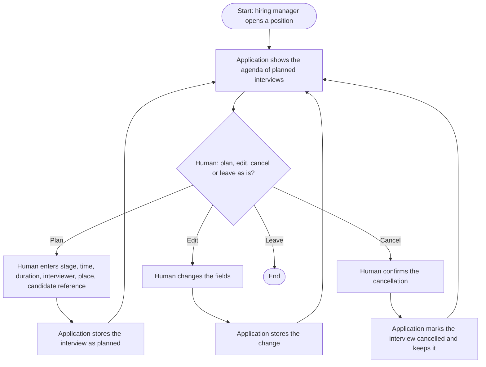
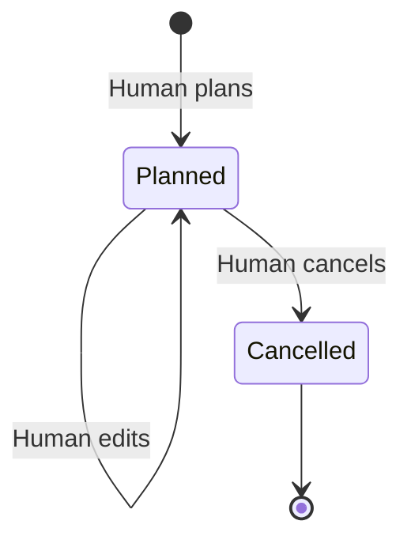

# Business specification: Interview calendar

Status: draft
Owner: hiring manager
Last reviewed: 2026-10-22

## Summary

For a position, the hiring manager plans its interviews in one place: stage, time, interviewer, place and the candidate reference. The application shows them as an agenda grouped by day. Planning an interview is the hiring manager's action; the application does not contact anyone.

## Business goal and success measures

- Goal: the hiring manager sees every planned interview for a position in one agenda and can change it without losing the record of what was planned.
- Success measure: for a position, every interview the hiring manager planned appears in the agenda with the stage, time and interviewer, and a cancelled interview stays visible as cancelled.

## Scope

In scope:

- Planning an interview for one position: stage, start date and time, duration, interviewer name, location or meeting link, candidate reference.
- Editing a planned interview.
- Cancelling an interview, which keeps it in the record.
- An agenda of the position's interviews, grouped by day, in time order.

Out of scope:

- Sending invitations or any message to a candidate or an interviewer.
- Syncing with Google Calendar or any other external calendar. Doing so would send candidate data off the machine (see the candidate data boundary).
- Exporting an ICS file. Can be added later without changing this model.
- Checking for clashes between interviews or interviewers.
- A calendar that spans several positions.
- Deleting an interview. Cancelling keeps the record.

## Actors

| Actor | Role in this process |
| --- | --- |
| Hiring manager | Plans, edits and cancels every interview. |
| Application | Stores the interviews and shows the agenda. Never plans or changes an interview by itself. |

No AI is involved. The application does not propose times or interviewers.

## Business process

## Lifecycle of an interview

## Business rules

1. BR-01: An interview belongs to one position and one stage of that position's process.
2. BR-02: An interview has a start date and time, and a duration between 5 and 480 minutes.
3. BR-03: Only the hiring manager's entries create, edit or cancel an interview. The application never does so on its own.
4. BR-04: A cancelled interview is never deleted and stays in the agenda, marked as cancelled.
5. BR-05: A cancelled interview cannot be edited again.
6. BR-06: The agenda shows the position's interviews in time order, grouped by the day they start.
7. BR-07: The candidate is referred to by a free-text reference. The application stores no other candidate detail in this feature.

## Data and records

- Interview: position, stage, start time, duration, interviewer name, location or meeting link, candidate reference, status (planned or cancelled), created and updated times. The hiring manager needs these to run the day.
- Retention: kept while the position exists. The retention rule for candidate references is an open question (see the candidate data boundary).

## Human decision points

- Planning an interview: the hiring manager enters every field. Nothing is saved until the hiring manager submits it.
- Editing an interview: the hiring manager changes the fields and submits.
- Cancelling an interview: the hiring manager confirms. Nothing is cancelled by a single accidental click.

## AI outputs

None. This feature does not call Claude.

## Candidate data boundary

- Stays on the machine: the candidate reference, the interview time and the interviewer name. Stored in SQLite under `data/`.
- Leaves the machine: nothing. No calendar service and no mail is called.

## Ticket breakdown

| Proposed ticket | Business rules covered | Status |
| --- | --- | --- |
| F0010: Interview calendar (plan, edit, cancel, agenda) | BR-01 to BR-07 | planned |

## Links

- Architecture: `../../docs/architecture/interview-calendar.md`
- Decisions: `../../docs/adr/0005-human-approval-for-every-ai-output.md`

## Open questions

- Candidate reference format: whether the hiring manager types a name, initials or a reference code. Assumed: free text, and the application does not validate it. The hiring manager should confirm this before candidate records (F0009) are built.
- Retention of candidate references. Assumed: kept as long as the position exists. To be decided with the open question in `CLAUDE.md`.
- Time zone. Assumed: the time is local to the machine, and no time zone is stored.

## Assumptions

- A single hiring manager uses the application on one machine, so there are no edit conflicts. Confirm if this changes.
- Stages are the fixed list in `backend/app/stages.py`.
